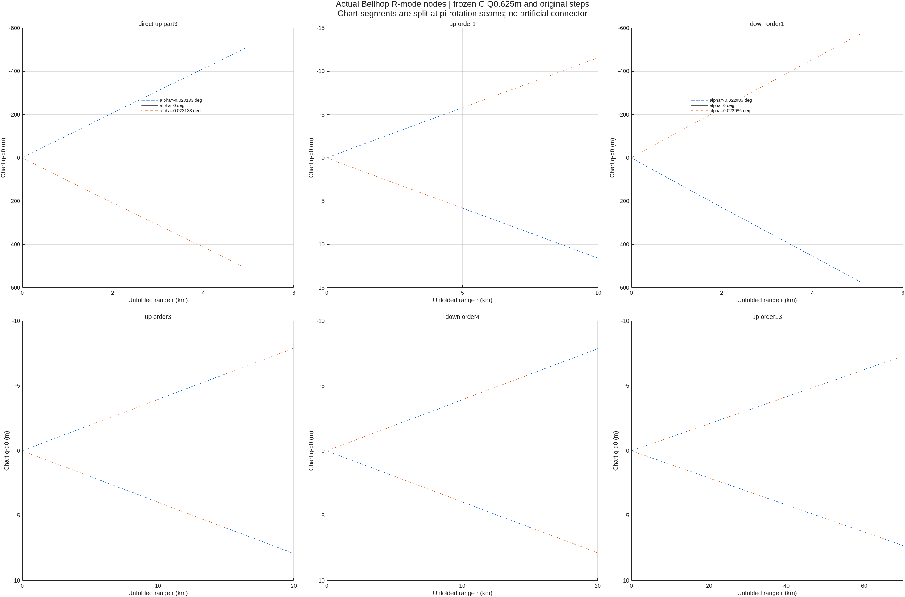
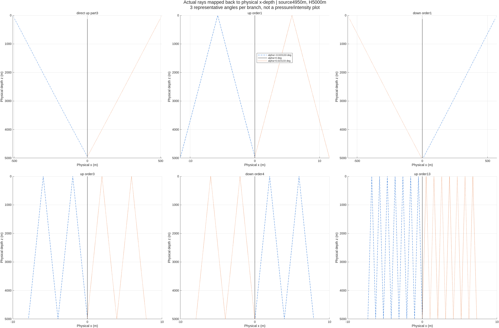

# Bellhop C工况代表声线：远程补齐与保存审计

2026-11-16，目标工作树 experiment/bellhop-rotated-fig12b。本次完成6类各3条真实声线、共18条轨迹与1,299,038个原生节点。旋转坐标和物理x-depth两套PNG/FIG及离线HTML已保存。停止等待人工审查。

[完整声线与已有相干TL图册](../results/visualization/bellhop_C_vs_FFP/20261116_rays_complete_01/index.html)；[交付checkpoint及预算](../results/validation/bellhop_rotated_fig12b/20261116_ray_remote_03/checkpoint_delivery.json)；[原共点比较报告](bellhop_C_FFP_common_point_2026-11-16.md)。

## 范围、输入与结果

远程复用已迁移Ubuntu快照、MATLAB R2025b Update1和gfortran13.3，没有重复迁移。冻结C介质和各分量传播步长、Q=0.625m、原10981×201接收网格、REAL8接收距离与平面墙优化保持。水深5000m、源深4950m、10kHz、全向3D点源（源宽N/A），平坦压力释放海面/流体底，Munk及底参数同冻结C。

只将代表性诊断任务设为R模式、各3束（对应原发射角区间端点及中点），没有计算接收复场；这不是401束生产分量或新的束数收敛实验。直达任务复用本轮先前已通过的R输出，最终运行只新增5项反射R作业，串行执行。

| 类别 | 每类声线 | 海面次数 | 海底次数 |
|---|---:|---:|---:|
| direct_up_part3 | 3 | 0 | 0 |
| up_order1 | 3 | 1 | 0 |
| down_order1 | 3 | 0 | 1 |
| up_order3 | 3 | 2 | 1 |
| down_order4 | 3 | 2 | 2 |
| up_order13 | 3 | 7 | 6 |

保留所有原生节点；作图只限制超出水体的末端guard点，不插值、不平滑。旋转图在每次π旋转的chart接缝处分段，物理图使用各段的方向/偏移映射，z向下。不同面板的水平跨度不同，应按各自坐标读图。alpha=0的竖直线只是几何路径，不是压力中央亮带。三束不能代表全部能量分布或证明束数收敛。

## 诊断导出修复及历史停止

20261116_ray_remote_01在MATLAB启动及预检消耗51.855731s后，原剩余8.409967s不足启动门，native为0。用户明确追加120s，仅用于本次声线补齐；累计上限改为3720s，原支出不重置。

remote_02的直达保存有效，但首海面R输出缺少反射前轨迹，严格映射审计拒绝。根因为既有validation overlay的TraceRay2D末尾无条件将ray2D压缩为最后墙后分支，这是场影响函数所需布局，却裁掉R导出的历史。原失败和日志保留；没有将截断曲线称作完整声线。

在remote_03/build独立诊断副本中仅对这段压缩增加条件：Beam%RunType(1:1)不等于R才执行，使R保留完整轨迹；C分支保持原语义。未修改官方Bellhop、PE或原C overlay，未重算C场。增量编译4s，原REAL8/平面墙源码保留。补丁及源码SHA随298文件返回清单封存。

- 原Linux C ELF SHA：5d87293a27e7fafc3aedefb569f3f35065294f42426503c4881d6eb55e6769e9，收尾远程复核仍相同。
- 新R导出专用ELF SHA：8bda11c1a905c9933e0cdceb869c3d3f4861dacac67fe00cc8c0a23228512cae。
- 本次只资格化R导出，未通过新C复场回归，也无需用此诊断ELF替换正式C求解器。

映射识别每面墙处相邻的入射/反射原生节点，在反射节点开始切换stage，避免同一墙坐标的两侧分支被错误归属。审计同时检查严格展开距离、墙次序、反射次数、π旋转q配对、物理接缝连续性及逆映射。

## 保存审计和资源账本

- 18条往返坐标/反射映射检查通过，最大往返误差4.5474735088646412e-13m，原门1e-8m未放宽。
- 6组接收声压零求值检查通过（R模式rr64eval不存在或仅8字节头），没有接收场计算。
- 102项重新打开FIG的X/Y数据逐位一致检查通过；两张PNG目视检查通过。
- 返回298文件SHA全部一致（205,116,268字节，含构建/数据/图件）；4个发布PNG/FIG与返回原件SHA一致。HTML相对引用检查通过。
- 最终6类有效R任务native合计3.462457s，含复用直达；最终新启动5项。连同先前首海面截断导出，整轮共7项native启动。没有A/B/C正式分量重算。
- remote_02 MATLAB全程18.323722839s；独立编译4s；remote_03 MATLAB全程75.048382044s（包含启动、读取、绘图与FIG复核）。新支出保留前次51.855731s停止和2s准备预留；不退款、不重置账本。
- 本地298项SHA审计1.1755322s，交付/看板收尾保守计20s，累计3712.139569167s，剩余7.860430833s，上限3720s。文件传输I/O沿用原账本口径单列，不冒充求解时间。
- 原1.5GiB启动/256MiB运行、120s单作业、15GiB输出及磁盘门不变。远端启动约50.5GiB可用，采用既有受控串行子进程运行器；无共享MATLAB终止、他人进程操作或全局配置修改。逐项资源记录随原始作业保存，未出现资源停止。

全部证据在[本次独立验证目录](../results/validation/bellhop_rotated_fig12b/20261116_ray_remote_03/)；早先remote_01/02停止/错误文件独立保留。执行源码位于本次目录的code/，原生输入、PRT/stdout/stderr/退出码、rays.mat/all_rays.mat、图件审计位于returned/20261116_ray_remote_03/。

## 结论和下一步

声线可视化缺口已关闭，已有C/FFP共点相干TL图直接链接并复用，不重新生成场。两场此前均不支持贯通窄中央亮带的结论不因几何竖直声线而改变。

A/B/C及已有FFP冻结数据、原REAL8构建、25个早期分量和历史失败记录均保留。本轮没有D、新FFP、接收复场重算、Git提交/推送/合并。剩余缺口是D束数、严格底DtN及差异归因、论文原始源/底假设；本轮不推进，等待人工审查。仅诊断R导出与图件交付改变，公共信道/DSP接口和生产公式不变，因此不运行通信回归、不改vertical_comm_guide.md。
