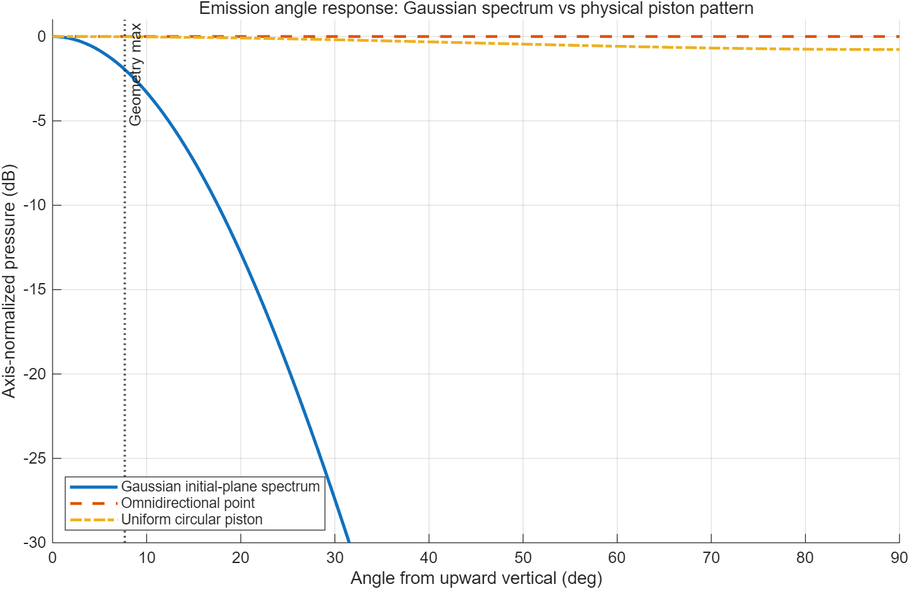
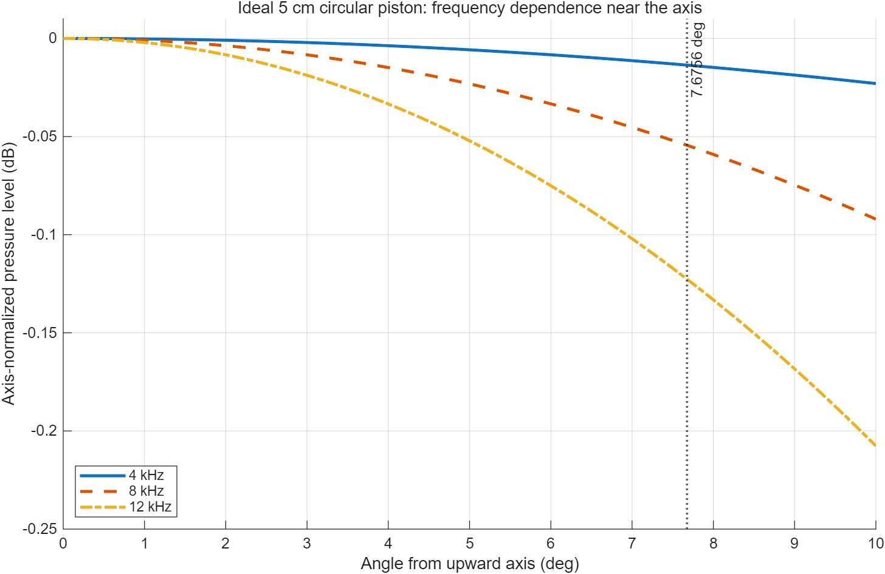
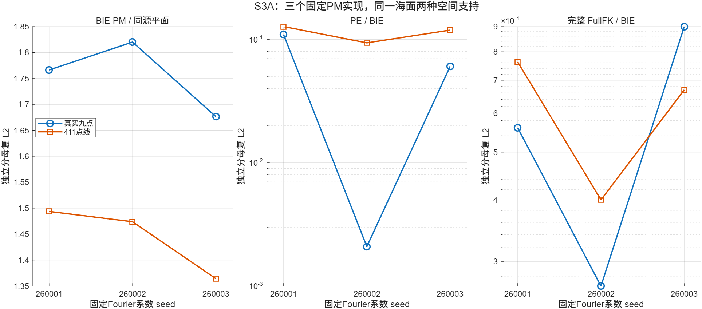

# 第4章 已取得的研究基础（修订稿 v0.2）

> 本稿包含第四章4.1和4.2。图件采用项目内既有图片；研究状态、数值和适用边界据本地正式报告及保存结果核对。

## 4.1 信道传播建模研究基础

围绕近垂直水声信道建模问题，前期已开展传播计算平台搭建、声源辐射特性分析、二维粗糙海面传播模型比较及三维深海固定海面传播研究，初步形成了从解析几何分析到数值传播计算和独立参考验证的研究基础。在程序实现方面，已建立基于抛物方程（Parabolic
Equation，PE）的垂直水声传播计算平台，采用广角抛物方程（Wide-Angle
Parabolic
Equation，WAPE）描述声场沿传播方向的演化，具备三维横向网格计算、Gaussian初始声场构建、平面海面及粗糙海面边界处理等功能，并能够分别提取直达、海面反射及总复频率响应。该平台为后续开展复杂海面条件下的传播建模和通信信道构建提供了程序基础。

针对论文关注的深海近海底设备向近海面接收平台传输的场景，前期首先开展了等声速条件下的解析几何分析。以水深1500
m、发射端距海底10 m为基本条件，考察了接收深度为3 m、6 m和10
m以及水平偏移0～200
m时的传播几何关系。采用镜像法分别计算直达路径、海面一次反射路径和海底一次反射路径的几何声程与到达时延。分析发现，在接收深度为10
m时，海面一次反射与海底一次反射具有相同的几何声程，其到达时延在所考察的水平偏移范围内完全重合。这表明，不同物理传播机制可能对应相同的几何时延位置，单纯依据离散信道中的时延峰值难以唯一确定其传播来源。该项分析为后续物理路径信息向通信级信道结构的转换，以及信道估计过程中先验不确定性的处理提供了几何依据。需要指出，上述结果基于等声速和平坦边界条件下的解析计算，仅反映几何到达时间关系，不代表实际传播声场中的路径幅度、相位或多径可分辨程度。

**图4-1** 等声速、平坦边界条件下直达路径（D）、一次海面反射路径（S）和一次海底反射路径（B）相对直达的解析到达时延。图示相对时延，不展示完整传播路径的空间几何或声场幅相。

在声源模型方面，针对后续传播计算中声源指向性对接收信号的影响，开展了Gaussian声源、理想全向点源和理想圆形活塞声源的最小化解析比较。实验采用水深1500
m、发射深度1490 m、接收深度6 m的几何条件，声速取1500 m/s，频率为4
kHz，水平偏移范围为0～200 m。Gaussian声源采用横向宽度参数为0.3
m的初始场角谱，理想圆形活塞声源采用半径为0.05
m的均匀活塞远场指向性模型，三种角度权重分别在轴上归一化，接收几何对照采用共同的几何扩散因子。结果表明，在最大水平偏移200
m、对应几何偏离角约7.6756°的条件下，Gaussian声源相对于全向点源的归一化声压级差为−1.9575
dB，而理想活塞声源的对应差值仅为−0.013597
dB。进一步针对半径不变的理想活塞模型开展4、8和12
kHz频率比较，在7.6756°处得到的相对轴上声压级分别为−0.013597、−0.054432和−0.122633
dB。上述结果表明，不同声源模型在目标近垂直几何下具有不同的离轴辐射特征，声源指向性是物理信道建模中需要考虑的因素。当前活塞声源结果仍属于独立的解析远场指向性比较，尚未完成活塞源面边界与现有PE传播求解器的统一接入；现有生产传播平台仍主要采用Gaussian初始声场。因此，该实验为后续声源模型选择提供了初步依据，但尚不能视为活塞换能器传播模型的验证结果。

**图4-2** 声源角度响应的解析比较：（a）4 kHz时Gaussian初始场角谱、理想全向点源和均匀圆形活塞的轴上归一化响应；（b）半径0.05 m的理想活塞在4、8和12 kHz下的频率变化。图中Gaussian曲线是初始场角谱权重，活塞曲线是解析远场指向性，均非生产PE传播结果或实测换能器方向图。

在二维粗糙海面传播研究方面，前期建立了同一声源及复场表示约定下的多种传播模型比较框架，针对抛物方程模式、边界积分方程（Boundary
Integral Equation，BIE）和完整双项Kirchhoff近似（Full Kirchhoff
Approximation，FullFK）开展了系统数值对照。该项研究采用4
kHz离散Gaussian声源，发射平面位于100 m深度，Gaussian宽度参数为0.3
m，离散角谱包含984项，在声速1500
m/s条件下，分别研究平面海面、三档确定性正弦起伏海面及固定随机粗糙海面实现下的反射复声场。为考察空间位置对模型差异的影响，分别设置九个真实接收位置和深度为3
m的411点接收线，并对两种接收支持独立计算复场误差。

平面海面控制结果表明，PE与BIE在411点接收线上的复场相对误差约为3.86×10⁻¹³，完整FullFK与BIE的对应误差约为3.29×10⁻¹⁶，说明在该固定声源和表示约定下，平面边界控制具有良好的数值一致性。在强正弦粗糙海面条件下，PE与BIE的411点接收线复场相对误差增至0.0629112，而完整FullFK与BIE的对应误差为4.29×10⁻⁵。进一步对三个预先确定的随机粗糙海面实现开展比较，得到PE与BIE的接收线复场相对误差分别为0.127452、0.093966和0.119206，完整FullFK与BIE的对应误差分别为7.63×10⁻⁴、4.00×10⁻⁴和6.69×10⁻⁴。不同海面实现及接收空间范围下的误差变化表明，粗糙海面条件下不同传播方法的复场差异具有一定的空间位置和海面实现依赖性，仅采用少数中心接收点难以完整反映接收区域内的模型差异。

**表4-1** 二维粗糙海面条件下不同传播方法在411点接收线上的反射复场相对误差。

| 海面条件 | PE/BIE | FullFK/BIE |
|---|---:|---:|
| 平面海面 | 3.855×10⁻¹³ | 3.286×10⁻¹⁶ |
| 强正弦粗糙海面 | 6.291×10⁻² | 4.292×10⁻⁵ |
| PM实现260001 | 1.275×10⁻¹ | 7.627×10⁻⁴ |
| PM实现260002 | 9.397×10⁻² | 4.001×10⁻⁴ |
| PM实现260003 | 1.192×10⁻¹ | 6.695×10⁻⁴ |

注：表中各项均以411点接收线上的BIE反射复场为分母；另行计算的九点误差使用九点支持上的独立分母，不与本表混用。BIE采用多层数值敏感性检查形成经验数值参考，并非严格数学误差界；FullFK属于Kirchhoff近似方法，不能视为精确全波解。三个PM样本仅代表三个固定海面实现，不用于推断随机海面总体统计规律。

**图4-3** 二维同源反射复场比较：（a）弱、中、强三档正弦海面在411点接收线上的原生幅度及包裹相位，不含残差曲线；（b）三个固定PM实现的PE/BIE与FullFK/BIE复场误差。后图的九点与411点为不同接收支持，各自使用独立分母，不可直接合并。

在三维深海传播方面，进一步针对水深1500
m的近垂直单链路开展了固定双模粗糙海面条件下的离散频率物理参考计算与跨频响应预测研究。该案例采用三维单位点Green声源，发射端位置为(0，150.5，1500)
m，接收端位置为(0，0，5) m，声速取1500
m/s，海面采用固定双模压力释放边界。与二维Gaussian声源研究不同，该项工作采用三维点源Green函数及独立的Dirichlet场展开（Field
Expansion，FE）方法构建物理参考。需要说明的是，FE在此处表示场展开方法，并非有限元方法。

该项研究首先以4、6和8 kHz三个离散频点建立初始跨频预测模型，并通过5和7
kHz两个新增频点开展独立检验。随后，在此基础上构建五锚点预测模型，利用4.5、5.5、6.5和7.5
kHz四个新增物理参考点比较不同预测模型的表现。最终，在五锚点模型及65点频率预测网格确定后，进一步预先冻结4.125、4.75、6.5625和7.25
kHz四个新频点的预测结果，再通过独立FE计算开展留出验证。由此，该固定三维案例累计获得13个不同的条件性物理参考频点。不同阶段的频点承担锚点、训练、模型选择和独立测试等不同作用，不能将历次预测记录重复计为独立测试样本；尤其是最终模型确定后的独立留出点为上述四个频率。

最终四个独立留出频点的反射复响应相对误差均小于10⁻³，非零粗糙反射增量误差和以直达场为标度的总场误差也均通过预先设定的筛查条件。具体结果见表4-2。其中，4.125
kHz和6.5625
kHz对应的总场存在较明显的分量相消，因而同时报告以直达场为标度的误差，以避免仅依据较小总场分母评价预测性能。四个频点的预测误差均通过相应筛查门，但7.25
kHz处的预测差仅约为FE经验数值敏感性的3.94倍，不能据此进一步宣称其预测精度明显高于参考数值分辨能力。

**表4-2** 三维固定双模海面条件下，最终预测器在四个独立留出频点的结果。

| 频率（kHz） | 反射误差 $e_R$ | 非零粗糙反射增量误差 $e_\Delta$ | 直达场标度的总场误差 $a_D$ | 预测差与FE经验敏感性之比 $\rho$ |
|---:|---:|---:|---:|---:|
| 4.125 | 3.232×10⁻⁵ | 1.759×10⁻⁵ | 3.004×10⁻⁵ | 42.21 |
| 4.750 | 5.932×10⁻⁵ | 3.013×10⁻⁵ | 5.515×10⁻⁵ | 34.35 |
| 6.5625 | 1.312×10⁻⁵ | 6.432×10⁻⁶ | 1.219×10⁻⁵ | 13.20 |
| 7.250 | 2.753×10⁻⁵ | 1.418×10⁻⁵ | 2.559×10⁻⁵ | 3.94 |

注：$e_R=|R_{\mathrm{pred}}-R_{\mathrm{FE}}|/|R_{\mathrm{FE}}|$，$e_\Delta=|\Delta_{\mathrm{pred}}-\Delta_{\mathrm{FE}}|/|\Delta_{\mathrm{FE}}|$，$a_D=|H_{\mathrm{pred}}-H_{\mathrm{FE}}|/|D|$，$\rho=|R_{\mathrm{pred}}-R_{\mathrm{FE}}|/\varepsilon_{\mathrm{FE}}$。FE经验敏感性 $\varepsilon_{\mathrm{FE}}$ 由保存的阶数、网格及计算域变体得到，并非连续问题的严格误差界。上述结果仅适用于固定点源、固定几何及双模海面条件下的离散频点预测。

**图4-4** 固定双模海面下最终模型的四个离散留出频点：（a）FE复反射参考与事前冻结预测及其复残差；（b）预测差和FE保存变体的经验敏感性。图中没有连续频带验证曲线。

上述三维研究表明，在固定传播几何和海面条件下，已经初步形成从离散物理参考计算、预测模型构建到新频点独立检验的研究流程，为进一步开展通信频带内的信道响应建模提供了数值研究基础。但其结论仍限于特定点源、固定双模海面和有限离散频点，尚未认证连续4～8
kHz复频率响应、无混叠信道冲激响应及端到端通信性能。对于原振幅PM随机海面，目前尚未取得通过独立数值参考认证的结果。此外，针对论文目标几何开展的生产PE/WAPE平面海面基准实验，在执行前孔径资格审查阶段发现现有验证窗口和吸收边界无法为目标接收位置提供充分的横向计算余量，因此未启动数值计算。目标深海几何下的生产PE/WAPE传播收敛性及宽带信道构建仍需在后续研究中进一步完成。

总体而言，前期工作已在声源辐射特性分析、二维粗糙海面复场比较和三维固定海面离散频率验证等方面形成一定研究积累，初步具备开展近垂直水声信道物理建模及数值验证的研究条件。同时，现有结果也表明，传播模型的适用性与声源表示、海面实现、接收空间范围及数值参考精度密切相关，为后续构建具有明确适用边界的通信级信道模型提供了前期依据。

## 4.2 信道估计与通信接收研究基础

在通信接收研究方面，前期已建立基于水声信道仿真数据的单载波QPSK/MPSK通信仿真平台，能够完成数字调制、信道抽头构建、信号卷积、噪声注入、相干解调以及误码率和符号错误率评价。在此基础上，已实现利用真实信道抽头构建的频域MMSE均衡基线，为后续研究有限导频信道估计和自适应均衡提供了基本通信仿真环境。现有接收平台主要用于已知信道状态信息（Channel
State
Information，CSI）条件下的通信性能评价，其均衡器直接使用仿真信道提供的有效抽头，尚不涉及从接收导频中估计未知信道的处理过程。

针对统计水声信道的通信性能，前期开展了U=5 m/s和U=8
m/s两个环境条件下的两节点通信验证。实验采用4～8
kHz频率范围内的64点信道频响，通信调制方式为QPSK，符号率为1
ksymbol/s，每条信道实现包含8000个符号，并在0～20
dB的Eb/N0范围内开展仿真。对于不同信道来源，每个环境节点采用32条信道实现，分别评价均衡前后BER和SER，并通过按信道实现聚类的方式估计统计置信区间。结果表明，未均衡条件下的BER约为0.50，说明在当前频率选择性衰落和随机复相位条件下，直接判决难以获得可靠通信；采用已知CSI频域MMSE均衡后，0
dB条件下BER降低至约0.13～0.21，20
dB条件下进一步降低至约0.002～0.007。不同信道来源在各Eb/N0条件下的聚类95%置信区间均存在重叠，表明在当前样本规模和接收基线下，条件统计信道生成方法能够复现相应信道来源的主要BER/SER统计趋势。

上述实验同时暴露出当前接收基线的局限。在无噪声条件下，均衡后仍存在约0.0022～0.0054的BER，且与高信噪比下的误码水平接近，说明当前误码底并非由噪声或信道统计生成误差单独造成，而与有限长度线性卷积采用循环频域均衡近似、帧首尾缺少保护间隔、信道抽头截断及均衡正则化等处理有关。因此，现有结果能够证明通信仿真链路和已知CSI均衡基线已经建立，但尚不能作为未知信道条件下接收算法性能的证明，也提示后续研究需要进一步完善帧结构、同步和均衡处理。

除两节点统计信道通信验证外，前期还开展了基于PE相位屏二维信道的分块QPSK通信模拟。在固定平面及弱正弦海面案例下，将4～8
kHz范围内的PE复频率响应统一映射至257点、64 ms时间窗口，并采用4
ksymbol/s的Gray编码QPSK信号进行仿真。接收处理采用512符号数据块和255符号循环前缀，使用已知CSI条件下的分块频域LMMSE均衡，对BER、分组错误率（Packet
Error Rate，PER）及误差矢量幅度（Error Vector
Magnitude，EVM）进行评价。在24
dB信噪比条件下，保存结果中的BER约为1.14×10⁻⁵，PER为0.0078125，EVM均方根约为0.217。该实验初步形成了由物理传播频响、时域信道表示、信号卷积、接收均衡到通信性能评价的仿真流程。但该结果仅适用于二维PE
Model-0相位屏的固定案例，采用已知CSI均衡，未包含导频信道估计、多普勒补偿、脉冲成形及实际海试噪声。运行检查点所列执行与审计脚本在当前工作树中均不存在；本地Git历史保存的两份脚本与检查点记录的SHA-256逐字节一致，保存的配置、收据、数据和独立审计也能对应，但本次未重新运行。因此，该结果仅作为现有通信仿真能力的补充证据，不作为RC2或RC3算法已经完成或正式二维宽带物理验证通过的依据。

在实测信道分析方面，前期选取公开BLACK深海垂直水声信道数据开展了初步处理。该数据对应约8720
m水深的深海垂直链路，发射端深度约8718 m，接收端深度约6
m，采用8阵元接收阵列，中心频率为18 kHz，测量带宽为12.5
kHz，本次分析使用的记录时长约36.552
s。通过对保存的时变复基带信道进行时延统计和相位变化分析，获得了时延---时间分布、平均功率时延谱及公共频移随时间变化等结果。在−25
dB抽头功率门限下，八个接收阵元的RMS时延扩展约为0.0737～0.0826
ms，90%能量区间宽度约为0.160～0.280
ms，门限保留的窗口内能量比例约为99.13%～99.37%。此外，通过对数据中单独保存的公共相位轨迹进行分段线性拟合，得到约−5.78～+5.47
Hz的公共频移变化范围，反映了该记录时段内信道相位和到达时延随时间变化的特征。

BLACK数据分析为后续研究动态水声信道的时间变化、到达结构和多普勒相关处理提供了实测数据基础。但该数据的传播距离、中心频率、阵列接收方式及测量带宽均与本课题目标1500
m、6
kHz单载波通信场景不同，因而可供后续设计接收算法时作补充外部评价；本阶段尚未完成此类评价。此外，当前保存的时延窗口为0～7
ms，不能确认其已覆盖目标场景下所有可能的反射到达，现阶段也未对时延谱中的弱峰进行具体物理路径归属。由保存相位轨迹拟合得到的公共频移属于实测数据特征分析，不等同于接收机从未知通信波形中完成的多普勒估计与补偿。

在离线信道统计方面，前期已实现从多条仿真信道样本中估计条件均值、跨频协方差及低秩特征的处理程序，并在固定环境条件下开展了统计信道生成及通信性能比较。这些统计量能够为后续分析信道结构、构建统计先验和研究低维表示提供数据基础，但其输入为预先生成的多条信道频率响应，并非接收端利用导频对当前未知信道进行估计，也未验证相邻时刻信道相关性及递推跟踪性能。

综上，现阶段已具备水声信道驱动的QPSK/MPSK通信仿真、已知CSI条件下的MMSE均衡、BER/SER及部分PER/EVM评价，以及公开实测信道的基础特征分析能力。这些工作为后续信道估计与通信接收算法研究提供了可复用的信道数据、通信链路和性能评价环境。与此同时，基于接收导频的LS、OMP、LMMSE及稀疏贝叶斯信道估计，物理几何先验辅助的有限导频估计与时变跟踪，以及利用估计信道初始化和在线更新均衡器的自适应接收算法，尚未形成已经完成的实现和独立验证结果。这些内容将作为后续RC2和RC3的主要研究任务，在现有通信仿真平台基础上进一步开展设计和验证。

**图4-5** U=8 m/s条件统计信道QPSK仿真中，直接判决与使用真实有效信道抽头的频域MMSE均衡的BER对照。该图不是未知CSI或在线自适应均衡结果。

**图4-6** BLACK公开实测信道的时变特征：（a）保存窗口内的时延—时间分布；（b）从保存相位轨迹拟合的公共频移及保存主抽头的残余谱。后者不是接收机从未知波形完成的多普勒估计与补偿。
