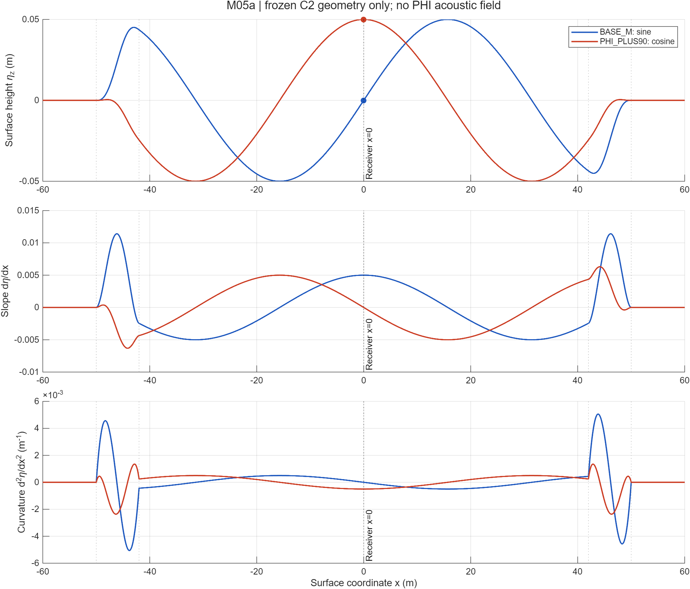
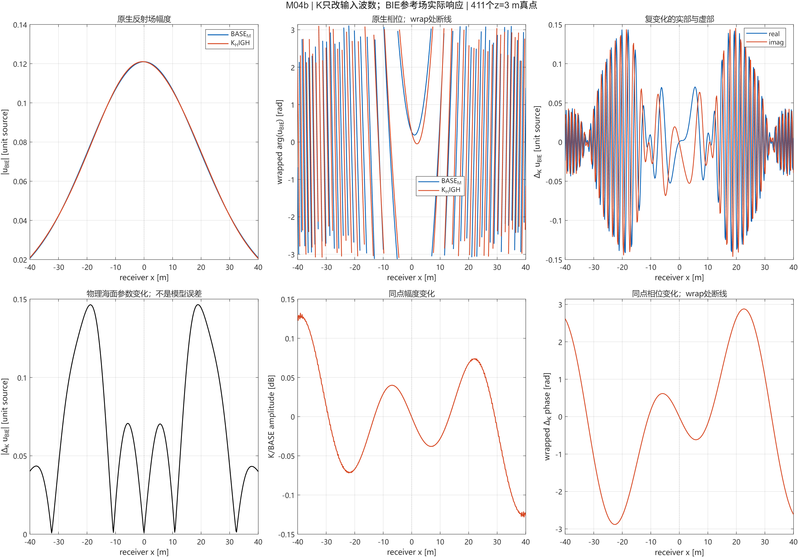
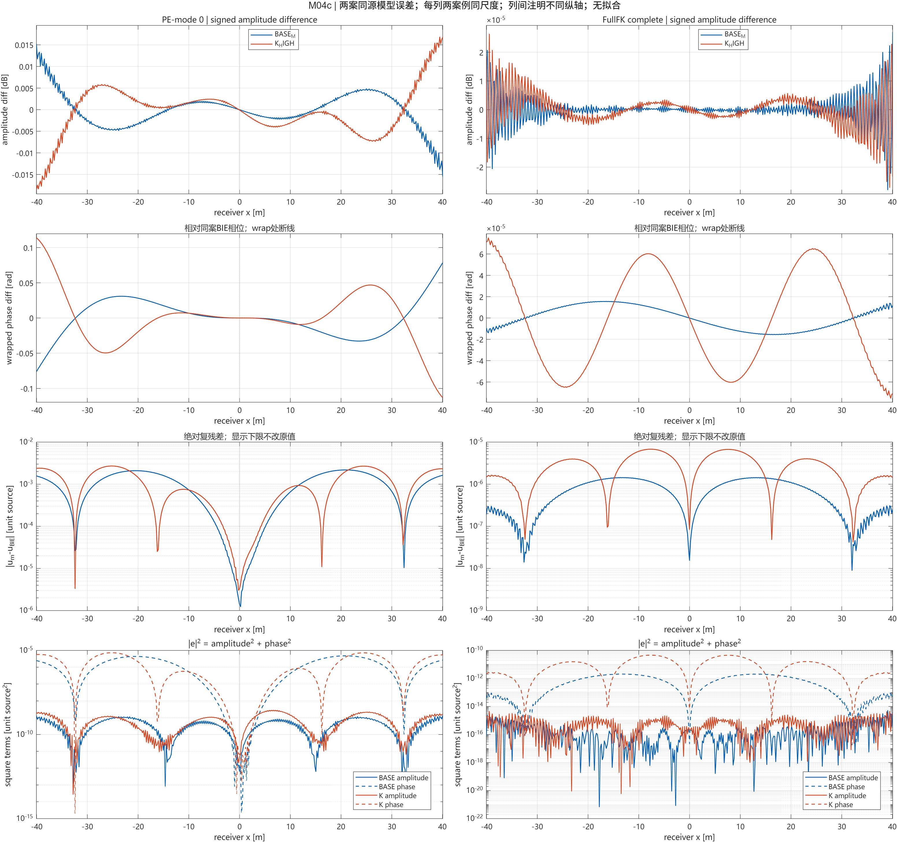
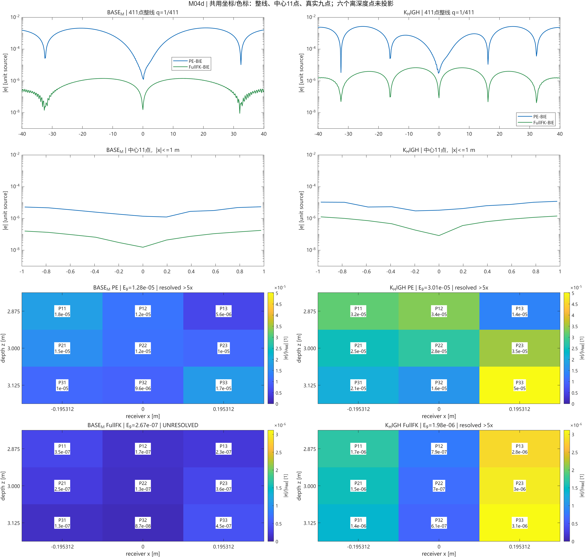

# M05：PHI_PLUS90 真实复场机理图册

**当前图像资格：**右上面板自动纵轴刻度造成的 M05c PNG 差异已通过固定显示刻度消除；[严格独立审计 v2](audit/final_independent_audit_phi_v2.json)的五张图独立重绘逐像素相等，原 v1 失败图和回执保留。下文图片使用 `figures_final_complete_v2/`，它们仍来自同一保存真复场。混合平台边界求解误差尚无直接上界，状态仍为 `S2C_B_PHI_PLUS90_DATA_COMPLETE_REFERENCE_LIMITED`。下条为修复前快照。

**补充复绘资格：**[逐对象 FIG 审计](audit/visual_semantics_phi_v1.json)显示 M05a–e 的全部轴、曲线与九点图像数据一致；M05c PNG 的 22,061 个栅格像素仍不同，严格逐像素门未 PASS。该差异未改变下列保存复数和各支持指标。[Linux 保存密度边界复核](audit/remote_saved_density_boundary_20261025.json)把跨平台算子残差差异压到 `1.04e-16/8.09e-17`，仍不构成同网格双平台边界求解误差的直接上界。

## 2026-10-25 SSH 续算图册（当前）

状态为 `S2C_B_PHI_PLUS90_DATA_COMPLETE_REFERENCE_LIMITED`。五层 PHI BIE、PE-mode0、完整双项 FullFK 的 417 点真实复场均已保存；M05b–e 由本地 R2025b 从这些 MAT 绘制。Windows R2025b 产生前两层 BIE，Ubuntu R2023b 产生后三层和 PE/FullFK。相同 Windows 密度在 Linux 上重评价 417 点复场差为 0，但这不能独立给出跨平台**边界求解**差的上界。下方旧“仅 M05a”文字是续算前历史状态。

**M05a 看到了什么：** φ 改变中心高度、坡度、曲率和整个 C2 海面排列；`|x|≥50 m` 仍严格平坦。**支持：**输入对照准确。**不能证明：**局部高度是模型误差的唯一原因。原 2026-10-23 正式图仍在 `figures_final/`；本组 M05a 从相同冻结 `geometry.mat` 独立重绘，原图副本也保存在 `figures_final_complete/`。

**M05b 看到了什么：** 两案 BIE 原生幅度接近，而复数场相位与复变化显著；BIE 物理响应在整线复 L2 为 `1.3929233`，中心 11 点为 `1.4816046`，各以 BASE_M BIE 在自身支持上的能量归一。**支持：**输入初相位改变真实参考场，必须把它与 PE/FullFK 模型残差分开。**不能证明：**这项变化仅由 x=0 的高度造成。

**M05c 看到了什么：** PHI 的 PE 整线复 L2 `0.0203315`，中心 11 点 `0.000509698`；BASE_M 分别为 `0.0155868`、`0.0000302940`。PHI 整线复残差平方的相位项占 `99.9395%`，中心幅度项占 `98.9967%`。FullFK 的 PHI 整线/中心为 `1.10184e-5/1.48944e-5`，与 PE 量级和空间模式不同。**支持：**中心与整线的机制、幅相贡献应分开读，PHI 中心 PE 误差增大约 `16.83` 倍仍只占其整线误差 `2.507%`。**不能证明：**相位平方项是独立物理致因，也不能由一条接收线推广为全二维场。

**M05d 看到了什么：** PHI 九点 PE 复 L2 `0.000506113`、FullFK `1.49251e-5`；BASE_M 九点 FullFK `2.66685e-7` 未过本案五倍经验门，PHI 九点在所记经验门上过线。图中九个色块对应九个真实接收点，六个离线深度点未插值。**支持：**完整线、中心和九点的误差分布不同。**不能证明：**经验门是严格误差上界；混合平台求解差仍未单独界定。

**M05e 看到了什么：** PHI 的复场和模型残差左右差显著低于 BASE_M，符合偶型输入的空间特征；CSV 保存 2502 行、每案每方法 417 对，复数配对独立复核最大差 `1.46e-15`。**支持：**±x 是有用的辅助诊断。**不能证明：**Nyquist 单项存在时严格场对称，或中心高度的独立因果作用。

[五支持指标](analysis/support_metrics.csv) · [成对变化](analysis/paired_changes.csv) · [真实复场](analysis/raw_fields.csv) · [五层参考版本](P1/BIE_reference_versions.csv) · [数值审计限制](independent_audit.md)。本组五张 PNG 均有同名可编辑 FIG。以下内容保留续算前的历史描述。

**2026-10-25 当前状态：** PHI 已获得 `main96/self64` 两层真实 BIE 场，但第三层前 RAM 门失败，尚无五层正式参考和 PE/FullFK 同点场。因此 M05a 仍是唯一正式 M05 图，M05b–e 不制作。两层仅用于数值自求积诊断，不能据此判断中心误差或将部分场标为正式参考。[恢复记录](execution.md)保存耗时、RAM 和数据 SHA。

预算已追加到 7506.601 s，但当前真实物理 RAM 未过门，用户要求暂时保持资源阻塞。下方 M05a 仍是正式几何图；声学 M05b–e 尚无真实 PHI 复场。预算和 RAM 数值见[执行补记](execution.md)，M05e 将来使用的坐标对称性检查见[输入审计](P1_symmetry_input_audit.md)。

[可编辑 FIG](figures_final/M05a_geometry_only.fig) · [解析几何 CSV](figures_final/geometry.csv) · [冻结协议和预算门](protocol.md)

## M05a：完整 C2 几何

**看到了什么：** BASE_M 在 x=0 过零，PHI_PLUS90 在 x=0 达 +0.05 m 波峰；中心坡度由 .005 变为 0，曲率由 0 变为 −.0005 m⁻¹。灰线为 `|x|=42/50 m` 的平台/窗口边界；中心接收机投影仅是 x=0，不表示唯一反射点。含窗口全域最大斜率和曲率见[汇总 CSV](figures_final/geometry_summary.csv)，不能用理想平台值替代。

**这些数据支持什么：** 只改变了输入初相位 φ，外侧 `|x|≥50 m` 保持严格平坦，解析几何已核验。这为未来完整 FullFK 解析平面外场补全保留几何前提。

**目前还不能证明什么：** 没有新 PHI 声场，中心 PE–BIE 或 FullFK–BIE 残差的方向、大小、可分辨性均未知。φ 同时改变整段海面，高度、坡度、曲率及传播干涉不能单独归因。

## 已合格 K_HIGH 图像，作为机制背景

下列四图原样复制到[轻量发布包](publication_review_M04/README.md)，只对应 `K_HIGH=(.05,.2,0)` 与 BASE_M，不代表 PHI 场：

**看到了什么：** K_HIGH 改变 BIE 参考场和模型残差；BASE_M 中心低误差与整线/边缘差异明显。详细固定支持指标见[原图册](../20261023_s2c_b_khigh_02/mechanism_atlas.md)。

**这些数据支持什么：** 已完成的 A、K 受控输入案例说明中心现象与空间支持、幅相贡献相关：保存逐点 CSV 复算的三档 A 情形 PE 整线相位平方占比约 `99.972–99.973%`，K_HIGH 为 `99.961%`。这是复差的代数分解，值得用初相位对照继续检查；这些位置不是独立海况样本。

**目前还不能证明什么：** A、K 和未来 φ 分别改变多项几何描述；现有 K_HIGH 场不能预测 PHI 的模型误差，更不能作局部过零的因果判定。M05b–e 和三参数声场总览因 PHI 参考门失败而未生成。

图形工作流参考：Kassis, T., Agarwal, V., He, Y., Patel, D., & Brueckner, A. M. (2026), *Scientific Agent Skills: A Library of Procedural Knowledge for Research Agents*, [arXiv:2609.00065](https://doi.org/10.48550/arXiv.2609.00065)。此文仅用于程序性绘图/审计方法，不作为声学证据。
