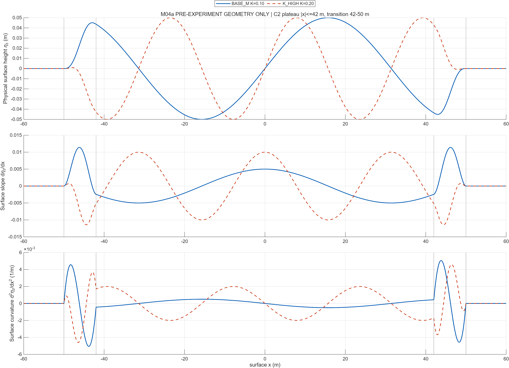

# K_HIGH M04 轻量公开复核包

这是既有合格 [K_HIGH 正式图册](../../20261023_s2c_b_khigh_02/mechanism_atlas.md) 的**逐字节副本**：四张 M04 PNG、BIE 物理响应 CSV、五支持模型指标 CSV、成对变化 CSV、最终独立审计 v4 JSON。每个载荷的字节数和 SHA-256 在 [清单](sha256_manifest.csv)。复制包不产生新数值或截图，不等于 GitHub 已发布；`.gitignore` 对本小包作精确放行，尚未 commit/push。

原始五层密度、417 点复场 MAT 和可编辑 FIG 仍在 K_HIGH 本地正式目录；它们分别约 0.2–2.7 MB/作业、0.08–0.75 MB/图。若需归档，应保留原路径与正式哈希清单 `provenance/P5_final_artifact_hashes_v6.csv`，按仓库大文件策略单独交付，不能把本 CSV 摘要视为原始密度替代品。复制包审计 JSON 的 SHA-256 为 `ffe4a0411dfc062c43e0e2eba4783b967477cc101e86ce61e00536919307b5e4`。
